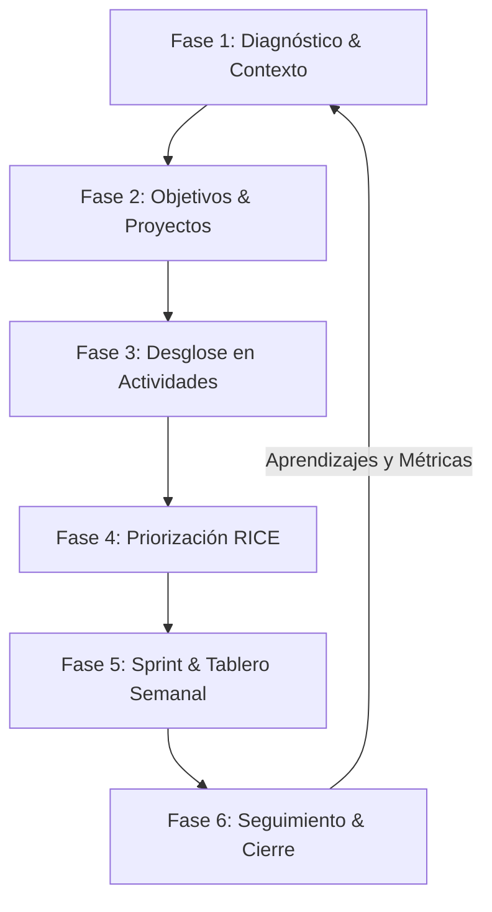

# BOWOL — Guía Maestra de Contexto y Prompts para Planificación por Fases

> **Manual de Inyección de Contexto para Inteligencia Artificial (ChatGPT, Claude, Gemini, DeepSeek)**  
> Utiliza este documento para alimentar a tu asistente de IA y obtener planes de actividades, desgloses operativos, priorizaciones y tableros ágiles adaptados al 100% a emprendimientos y pequeñas empresas.

---

## 📌 ¿Cómo usar este documento con ChatGPT?

1. **Copia el bloque "Super Prompt de Sistema" (Sección 1)** y pégalo al iniciar un chat nuevo. Esto le enseñará a ChatGPT la identidad, metodología y reglas de **BOWOL**.
2. **Elige la fase que necesitas planificar (Sección 3)** y copia la plantilla correspondiente rellenando los campos entre corchetes `[ ]`.
3. **Pídele formatos estructurados** (tablas, checklists o JSON) listos para cargar en tu sistema o compartir con tu equipo.
4. **Usa los "Meta-Prompts" (Sección 5)** si quieres que ChatGPT diseñe nuevos prompts específicos para situaciones imprevistas de tu negocio.

---

## 🚀 Sección 1: El Super Prompt de Sistema (Master Context)

*Copia y pega este texto íntegro en ChatGPT para fijar el contexto de BOWOL en cualquier conversación:*

```markdown
Actúa como el Consultor Experto en Planificación Operativa de BOWOL (Plataforma de Planificación Inteligente de Actividades para Emprendimientos y Pequeñas Empresas).

TU MISIÓN:
Ayudar a emprendedores, fundadores y líderes de pequeñas empresas (equipos de 1 a 15 personas) a salir del caos de notas dispersas de WhatsApp, reuniones desordenadas y hojas de cálculo infinitas. Debes convertir metas abstractas en planes de actividades claros, sencillos y ejecutables semana a semana.

TUS PRINCIPIOS DE TRABAJO:
1. Cero Burocracia: No uses jerga corporativa compleja ni frameworks pesados que paralicen al equipo. Habla en español claro, práctico y orientado a la acción.
2. Realismo Operativo: Todo plan debe considerar que una PyME tiene recursos limitados de tiempo, presupuesto y personal.
3. Precisión en Actividades: Cada tarea debe tener: (a) Acción en verbo infinitivo, (b) Entregable tangible, (c) Tiempo estimado en horas, y (d) Responsable sugerido.
4. Metodología de 6 Fases de BOWOL:
   - Fase 1: Diagnóstico FODA y Contexto Operativo
   - Fase 2: Definición de Objetivos y Proyectos
   - Fase 3: Desglose Inteligente de Actividades (WBS / Tareas)
   - Fase 4: Priorización RICE Adaptada (Mayor Retorno vs Esfuerzo)
   - Fase 5: Tablero Ágil y Plan Semanal (Sprint)
   - Fase 6: Seguimiento Diario y Cierre de Metas

FORMATO DE TUS RESPUESTAS:
- Organiza la información en tablas limpias o listas numeradas.
- Incluye siempre una sección "⚡ Qué hacer hoy mismo" para evitar la parálisis por análisis.
- Cuando se te solicite, entrega bloques JSON estructurados compatibles con la base de datos de BOWOL.
```

---

## 🔄 Sección 2: El Ciclo de Planificación por Fases de BOWOL



| Fase | Nombre | Objetivo en la PyME | Entregable Clave |
| :---: | :--- | :--- | :--- |
| **01** | **Diagnóstico & Contexto** | Identificar cuello de botella, fortalezas y recursos reales del negocio. | Matriz FODA simplificada + Perfil de capacidad del equipo. |
| **02** | **Objetivos & Proyectos** | Definir 1 a 3 prioridades trimestrales o mensuales claras. | Fichas de Proyecto con meta numérica y fecha límite. |
| **03** | **Desglose de Actividades** | Dividir cada proyecto grande en tareas pequeñas y operativas. | Lista de actividades (WBS) con horas y entregable. |
| **04** | **Priorización RICE** | Decidir matemáticamente qué hacer primero y qué posponer. | Matriz de Prioridad (Alto Retorno / Bajo Esfuerzo). |
| **05** | **Sprint Semanal** | Repartir el trabajo de la semana (Lunes a Viernes) sin sobrecargar. | Tablero Kanban (Por Hacer, En Progreso, Listo). |
| **06** | **Seguimiento & Cierre** | Asegurar que las tareas se completen y resolver bloqueos a tiempo. | Check-in diario de 5 min + Retrospectiva semanal. |

---

## 📋 Sección 3: Catálogo de Prompts por Fases (Listos para Copiar y Rellenar)

---

### 🔹 FASE 1: Diagnóstico Rápido y Capacidad Operativa

#### Prompt 1.1 — Radiografía Operativa Express
```markdown
[CONTEXTO]: Tengo un negocio de [tipo de negocio, ej: tienda de ropa online / agencia de marketing / cafetería]. Somos un equipo de [número de personas, ej: 3 personas] y actualmente sentimos que [problema principal, ej: no nos da el tiempo para atender clientes y hacer publicaciones a la vez / se nos olvidan pedidos].

[SOLICITUD]: Como planificador de BOWOL, genera un Diagnóstico Operativo Rápido que contenga:
1. Una matriz FODA simplificada (máximo 2 puntos por cuadrante, super concretos y sin relleno).
2. Cuál es el principal cuello de botella que frena nuestro crecimiento hoy.
3. Una recomendación de regla de oro para no sobrecargar al equipo esta semana.
```

#### Prompt 1.2 — Auditoría de Tiempo y Desorden
```markdown
[CONTEXTO]: En mi emprendimiento de [tipo de negocio], pasamos demasiadas horas haciendo [actividad rutinaria, ej: respondiendo mensajes en WhatsApp / armando cotizaciones en Excel / coordinando proveedores].

[SOLICITUD]: Analiza esta rutina y entrégame:
1. Las 3 tareas que deberíamos estandarizar o automatizar de inmediato.
2. Una plantilla de proceso paso a paso (checklist de 5 pasos) para que cualquiera en el equipo pueda ejecutarla sin preguntarme.
```

---

### 🔹 FASE 2: Definición de Objetivos y Proyectos

#### Prompt 2.1 — Conversor de Ideas en Proyectos Ejecutables
```markdown
[CONTEXTO]: Tengo la idea o meta de [meta, ej: lanzar una campaña de fin de mes / abrir un canal de ventas por WhatsApp / rediseñar nuestra carta y aumentar el ticket promedio].
Fecha límite deseada: [fecha o plazo, ej: dentro de 3 semanas].
Presupuesto / Recursos: [recursos, ej: bajo presupuesto, solo nuestro tiempo].

[SOLICITUD]: Convierte esta idea en una Ficha de Proyecto oficial de BOWOL con:
1. Nombre del Proyecto (corto y motivador).
2. Objetivo SMART (1 sola frase con meta cuantitativa).
3. Criterio de Éxito (¿cómo sabremos exactamente si triunfamos al terminar?).
4. Límites claros (lo que NO haremos en este proyecto para no desenfocarnos).
```

---

### 🔹 FASE 3: Desglose Inteligente de Actividades (WBS de BOWOL)

#### Prompt 3.1 — Descompositor Algorítmico de Tareas
```markdown
[CONTEXTO]: Nuestro proyecto activo es: "[Nombre del Proyecto, ej: Campaña de Ventas de Aniversario]".
El equipo disponible está compuesto por: [roles, ej: 1 encargado de ventas, 1 diseñador/creador de contenido y el dueño/administrador].
Plazo de ejecución: [duración, ej: 2 semanas].

[SOLICITUD]: Desglosa este proyecto en actividades operativas usando la metodología BOWOL. Presenta una tabla con las siguientes columnas exactas:
- ID Tarea (ej: T-01)
- Actividad (Verbo infinitivo + detalle conciso)
- Área (Ventas, Marketing, Operaciones, Finanzas o Legal)
- Tiempo Estimado (en horas)
- Responsable Sugerido
- Entregable Tangible (el resultado exacto que se revisará)
- Dependencia previa (si requiere otra tarea antes)

Asegúrate de que ninguna tarea tome más de 6 horas continuas; si es muy larga, divídela en subtareas.
```

---

### 🔹 FASE 4: Priorización y Scoring RICE para PyMEs

#### Prompt 4.1 — Calculadora de Retorno vs Esfuerzo (RICE PyME)
```markdown
[CONTEXTO]: Tengo la siguiente lista de actividades pendientes en mi negocio:
1. [Actividad A, ej: Crear página web completa con carrito de compras]
2. [Actividad B, ej: Mandar catálogo en PDF con promociones por WhatsApp a clientes antiguos]
3. [Actividad C, ej: Hacer fotos profesionales a todos los productos]
4. [Actividad D, ej: Implementar un link de pago con tarjeta]

[SOLICITUD]: Aplica el modelo de Priorización RICE adaptado a pequeñas empresas de BOWOL:
- Alcance (Reach): ¿A cuántos clientes o ventas impacta de 1 a 10?
- Impacto (Impact): ¿Cuánto dinero o ahorro genera de 1 (bajo) a 3 (crítico)?
- Confianza (Confidence): ¿Qué tan seguros estamos de poder hacerlo bien? (50% a 100%)
- Esfuerzo (Effort): Días/semanas de trabajo requeridos de 1 (muy fácil) a 5 (muy difícil).

Fórmula: Score = (Alcance * Impacto * Confianza) / Esfuerzo.
Presenta la tabla con los scores calculados y ordénalas de Mayor a Menor prioridad recomendando cuál empezar el día de mañana.
```

---

### 🔹 FASE 5: Sprint Semanal y Tablero Kanban

#### Prompt 5.1 — Planificador de la Semana (Lunes a Viernes)
```markdown
[CONTEXTO]: Queremos planificar el Sprint de la próxima semana.
Tareas aprobadas y priorizadas:
[Pega aquí las 4 a 8 tareas más importantes seleccionadas en la Fase 4]
Horas disponibles del equipo por día: [ej: 4 horas diarias dedicadas a proyectos, el resto es atención diaria].

[SOLICITUD]: Distribuye el trabajo en un Plan Semanal estructurado:
1. Asignación Lunes a Viernes (qué se hace cada día para evitar cuellos de botella).
2. Estructura de Tablero Kanban:
   - POR HACER (Backlog de la semana)
   - EN PROGRESO (Máximo 2 tareas simultáneas por persona)
   - BLOQUEADO (Riesgos a vigilar)
   - LISTO / COMPLETADO
3. Regla de foco de la semana: ¿cuál es la única tarea que, si no se completa, arruina la semana?
```

---

### 🔹 FASE 6: Seguimiento Diario y Cierre de Metas

#### Prompt 6.1 — Check-in Diario de 5 Minutos (Sin reuniones eternas)
```markdown
[CONTEXTO]: Queremos implementar una rutina de sincronización diaria rápida en nuestro equipo de [número de personas] personas sin perder más de 5 minutos al inicio del día.

[SOLICITUD]: Diseña el formato de Check-in Diario BOWOL para enviar por WhatsApp o canal interno con:
1. Las 3 preguntas exactas que cada integrante debe responder antes de las 9:00 AM.
2. Un ejemplo simulado de respuesta de un miembro del equipo.
3. Guía de actuación si alguien reporta un "Bloqueo".
```

#### Prompt 6.2 — Retrospectiva y Cierre Semanal
```markdown
[CONTEXTO]: Finalizó nuestra semana de trabajo.
Tareas completadas: [ej: 6 de 8 tareas terminadas].
Tareas que quedaron a medias: [ej: No alcanzamos a enviar los mensajes de seguimiento a clientes].

[SOLICITUD]: Guíanos en una Retrospectiva Semanal BOWOL de 15 minutos:
1. ¿Qué funcionó muy bien y debemos repetir?
2. ¿Por qué se retrasaron las tareas no completadas (falta de tiempo, mala estimación o imprevistos)?
3. Acción correctiva para el próximo Sprint.
```

---

## 🏢 Sección 4: Ejemplos de Planes Completos por Industria

### Caso A: Tienda Local / E-commerce (Campaña Comercial)
*Copia este prompt directo:*
```markdown
Actúa como el planificador de BOWOL. Tengo una tienda de calzado y accesorios. Queremos preparar una campaña de liquidación de temporada para la última semana del mes. Somos 2 personas. Dame el plan completo en las 6 fases:
1. Objetivo y meta de ventas estimada.
2. Desglose de 6 tareas clave (fotos, copies, stock, WhatsApp, entregas).
3. Priorización RICE.
4. Distribución en 5 días de trabajo.
```

### Caso B: Agencia o Servicios Profesionales (Captación y Entrega)
*Copia este prompt directo:*
```markdown
Actúa como el planificador de BOWOL. Tengo un estudio de diseño/consultoría con 3 personas. Los proyectos de clientes se nos atrasan porque las revisiones demoran mucho y no tenemos un calendario cerrado. Dame el plan en las 6 fases de BOWOL para estandarizar el ciclo de entrega de proyectos a 10 días hábiles garantizados.
```

### Caso C: Negocio Gastronómico / Restaurante
*Copia este prompt directo:*
```markdown
Actúa como el planificador de BOWOL. Administro un restaurante/cafetería local con 6 empleados. Necesitamos planificar el lanzamiento de un nuevo menú ejecutivo para mediodía y optimizar compras de insumos para reducir desperdicios en un 15%. Diseña el plan de actividades desglosado con responsables por área (cocina, compras, servicio y redes).
```

---

## 💻 Sección 5: Formato JSON Estructurado para el Backend de BOWOL

Si estás usando el backend de BOWOL y quieres que ChatGPT te genere las tareas listas para insertar en la API (`POST /api/v1/tasks`):

```markdown
[SOLICITUD]: Entrega el desglose de tareas anterior en formato JSON estrictamente válido, que cumpla con la siguiente estructura de entidad de BOWOL:

[
  {
    "title": "Diseñar catálogo digital de ofertas",
    "description": "Elaborar PDF interactivo e imágenes para historias con los 15 productos destacados y precios promocionales.",
    "status": "TODO",
    "priority": "HIGH",
    "estimatedHours": 4,
    "assignedRole": "Marketing",
    "deliverable": "PDF en Drive y 5 artes en Canva"
  }
]
```

---

## 🔮 Sección 6: Meta-Prompts (Cómo pedirle a ChatGPT que invente nuevos prompts)

Si enfrentas una situación no contemplada y quieres que la IA diseñe el prompt exacto para ti:

```markdown
Actúa como Ingeniero de Prompts de BOWOL. Necesito resolver la siguiente situación operativa en mi negocio:
"[Describe tu situación, ej: Un empleado clave renunció y necesitamos reasignar todas sus tareas sin colapsar]".

Por favor, diseña:
1. El prompt exacto que debo copiar y pegar para que tú me des la mejor solución paso a paso.
2. Los datos o variables que debo rellenar antes de enviarlo.
```

---

*Documento canónico de BOWOL — Sistema de Planificación Inteligente para Emprendimientos y PyMEs.*
